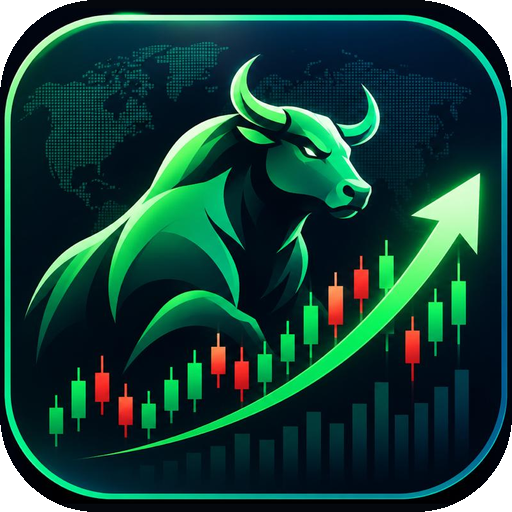

<p align="center"></p>

# STOCKMIND AI – Intelligent Stock Market Analytics

**MSc AI/ML Capstone Project | Course: MAI511-2 (Advanced Machine Learning)**  
**Student Name:** Divyarajsinh Rathod  
**Register Number:** 2648542  

## Overview
STOCKMIND AI is an end-to-end machine learning stock market analytics and price prediction platform built in Python and Streamlit, integrating all 5 units of the `MAI511-2` Advanced Machine Learning syllabus.

## Installation & Running Locally (macOS / VS Code)
```bash
cd /Users/rathoddivyarajsinhyashpalsinh/CapstoneAML
/usr/local/bin/python3 -m pip install -r requirements.txt
/usr/local/bin/python3 -m streamlit run app.py
```

## UI / Design — "Neon Bull" theme
The interface is styled around the StockMind bull logo:
- **Palette:** near-black navy base, neon bull-green `#2EE88A` (gains, active states), teal `#1FB5E0` (secondary), candle-red `#FF4D5E` (losses), amber `#F7B955` (caution).
- **Type:** Space Grotesk (headings), Inter (body), JetBrains Mono (prices & numbers).
- **Components:** branded sidebar with logo + live status, scrolling market ticker tape, glass hero banner with day stats, glowing KPI tiles, segmented controls, 4-segment technical signal gauge, neon charts with glow lines and range selector.
- Theme tokens live in `src/ui_components.py` (CSS) and `src/visualization.py` (chart colours); native widget colours come from `.streamlit/config.toml`.

## Project Structure
- `assets/`: Logo (`logo.png`), small inline copy (`logo_128.png`) and favicon.
- `.streamlit/config.toml`: Dark base theme with the brand green as primary colour.
- `src/ui_components.py`: Neon Bull design system (global CSS + hero, tape, KPI, signal meter, footer components).
- `app.py`: 11-section Streamlit financial analytics application.
- `src/data_collection.py`: Yahoo Finance (`yfinance`) historical OHLCV fetcher with local CSV caching in `data/`.
- `src/preprocessing.py`: Chronological forward-fill cleaning, 80/20 time-series split, and leakage-free `StandardScaler`.
- `src/feature_engineering.py`: 19 technical indicators (SMA, EMA, RSI, MACD, Volatility, Volume Ratio, Lags).
- `src/regression.py`: Unit 1 — OLS, Gradient Descent, Simple/Multiple/Multivariate/Polynomial Regression, Ridge, Lasso, Decision Tree, Model Tree, and Logistic Regression.
- `src/dimensionality_reduction.py`: Unit 2 — Low Variance Filter, High Correlation Filter, Forward/Backward Selection, mRMR, Factor Analysis, PCA, LDA, ICA, MDS, and Isomap.
- `src/clustering.py`: Unit 3 — Hopkins Statistic, K-Means, K-Medoids (PAM), Agglomerative & Divisive (DIANA) Hierarchical Clustering, BIRCH, Chameleon, Elbow, Silhouette, Davies-Bouldin, and Calinski-Harabasz.
- `src/reinforcement_learning.py`: Unit 4 — K-Armed Bandit, Model-Based Dyna-Q, and Model-Free TD Q-Learning trading simulation.
- `src/neural_network.py`: Unit 5 — Single Neuron Binary/Bipolar Sigmoid & ReLU calculator (Lab Ex 9), Single-Layer Perceptron, and MLP Backpropagation classifier (Lab Ex 10).
- `src/prediction.py`: End-to-end next-day closing price estimator and multi-day statistical projection.
- `src/visualization.py`: Dark-themed Plotly financial charts and Matplotlib hierarchical dendrograms.
